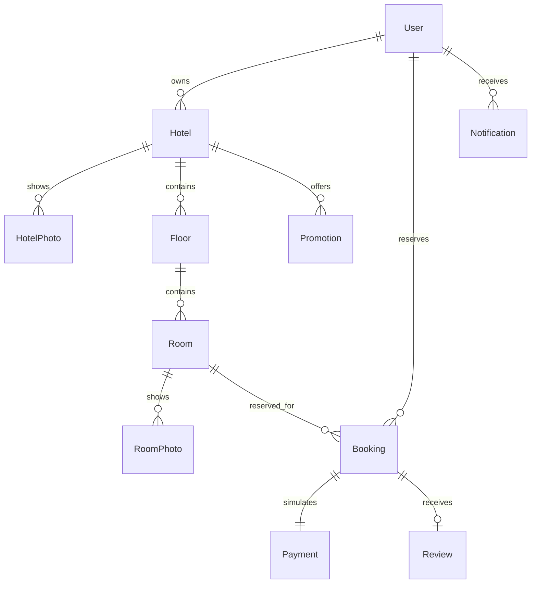

# Architecture

Vue Router pages call the Axios service. Pinia holds the authenticated profile and hotel comparison IDs. Vite proxies API and media requests to Django; no database connection is made from the browser. Django REST Framework validates input and authorizes every mutation. MariaDB InnoDB stores all domain records.

Each domain has its own Django app. Reports are projections of existing tables and need no duplicate report model. Explicit serializers prevent mass assignment of owner, role, price totals, verification status, or payment status. Querysets scope reservations, payments and notifications to the authorized user. Ownership checks also run on writes to visible hotels, rooms and floors; a public read does not confer edit access.

The reservation service locks the room, checks current property/room status and capacity, rechecks half-open overlap `[check_in, check_out)`, calculates a Decimal total, applies a currently valid hotel promotion, and inserts booking/payment/notices inside one transaction. All booking creation paths exposed by REST use that service. Direct administrative database edits must preserve those invariants. Cancellation locks room then booking in the same order to avoid an inconsistent release.

Django migrations are the table-definition authority. Database constraints enforce room numbering/positions, positive prices/capacity/guests, valid booking/promotional dates, and one-to-one payment/review relations. Overlap prevention needs transaction locking because MariaDB has no range exclusion constraint.

Environment files and media are ignored by version control. Media routes are served by Django only in local debug mode. The maintained dependency profile requires a newer MariaDB server; the XAMPP compatibility profile is explicitly local-only.

Room status is a serializer projection of Room.active and confirmed date overlaps, not a separate mutable booking-status column. The API exposes read-only availability_status and manager-scoped can_delete. The same availability boolean remains backward-compatible. Report day windows use timezone-aware timestamp ranges to avoid requiring MySQL timezone lookup tables. MapLibre and its Vite-bundled worker load when the map is opened; Leaflet provides an explicit fallback. No map API key is stored.
